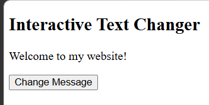
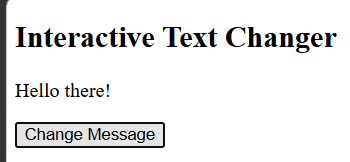
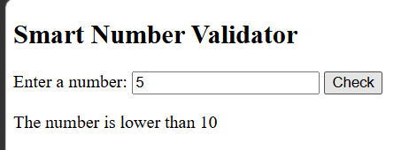
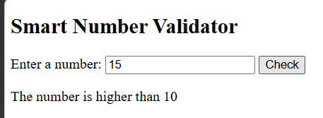
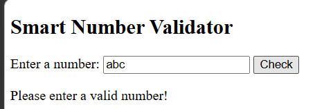
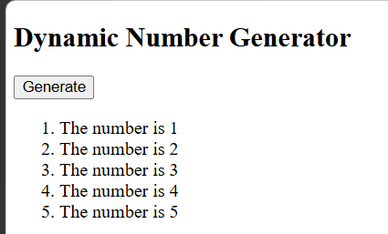

# BIC21203 Web Development - Lab 4a
## Client-Side Scripting (JavaScript)

### Student Information
- **Name:** Mohamad Fauzan Fikri Bin Mohamad Zamri
- **Student ID:** AI250135
- **Course Code:** BIC21203
- **Course Name:** Web Development
- **Lab Title:** Lab 4a - Client-Side Scripting (JavaScript)

---

## Introduction

This lab focuses on using JavaScript to develop interactive web pages. It covers JavaScript functions, event handling, conditional statements, input validation, loops, and DOM manipulation.

The lab consists of three questions that demonstrate how JavaScript can update webpage content, validate user input, and generate HTML elements dynamically.

---

## Question 1: Interactive Text Changer

### Objective
To change a paragraph's text when the user clicks a button.

### Description
The webpage initially displays "Welcome to my website!". When the user clicks the "Change Message" button, the paragraph changes to "Hello there!".

### JavaScript Concepts Used
- `document.getElementById()`
- JavaScript functions
- `addEventListener()`
- `textContent`

### How to Run
1. Open the `Q1` folder.
2. Open `index.html` in a web browser.
3. Click the "Change Message" button.
4. Verify that the message changes to "Hello there!".

### Screenshot
Before

After

---

## Question 2: Smart Number Validator

### Objective
To validate user input and display a message based on the entered number.

### Description
The webpage accepts a number and compares it with 10. It displays whether the number is lower than, higher than, or equal to 10. Invalid or empty input displays an error message.

### JavaScript Concepts Used
- Input validation
- `Number()`
- `Number.isNaN()`
- `if...else if...else`
- `textContent`
- `addEventListener()`

### Test Cases

| Input | Expected Output |
|---|---|
| 5 | The number is lower than 10 |
| 10 | The number is equal to 10 |
| 15 | The number is higher than 10 |
| abc | Please enter a valid number! |
| Empty input | Please enter a valid number! |
| 10.5 | The number is higher than 10 |

### How to Run
1. Open the `Q2` folder.
2. Open `index.html` in a web browser.
3. Enter a number in the input field.
4. Click the "Check" button.
5. Verify that the displayed message matches the input.

### Screenshots
Lower Than 10

Equal to 10

Higher Than 10

Invalid Input

---

## Question 3: Dynamic Number Generator

### Objective
To generate an ordered list containing numbers from 1 to 5 using JavaScript.

### Description
When the user clicks the "Generate" button, JavaScript creates five list items dynamically. Existing list items are cleared before generating a new list to prevent duplicates.

### JavaScript Concepts Used
- JavaScript functions
- `for` loop
- `document.createElement()`
- `textContent`
- `appendChild()`
- `addEventListener()`

### Expected Output
1. The number is 1
2. The number is 2
3. The number is 3
4. The number is 4
5. The number is 5

### How to Run
1. Open the `Q3` folder.
2. Open `index.html` in a web browser.
3. Click the "Generate" button.
4. Verify that five list items are displayed.
5. Click the button again and confirm that duplicate items are not created.

### Screenshot

---

## Reflection

Through this lab, I learned how to use JavaScript functions and event listeners to make web pages interactive. I practised validating user input using conditional statements and handling invalid values correctly. I also learned how to use a for loop and DOM manipulation methods to generate HTML elements dynamically. In addition, I understood the importance of clearing existing elements to prevent duplicate output. Overall, this lab improved my understanding of client-side scripting and the interaction between JavaScript and HTML.
